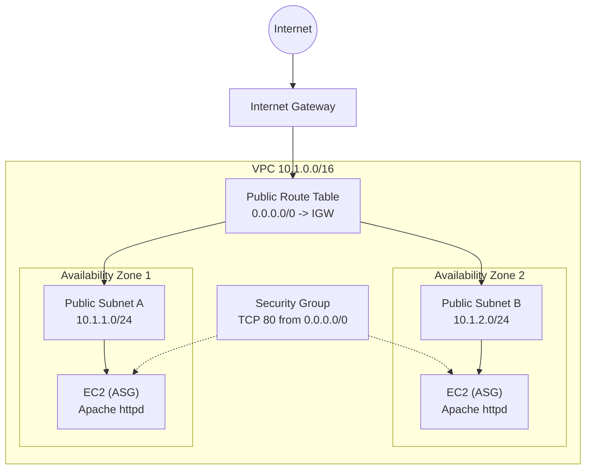

# Resilient 2-AZ Web Tier on AWS (CloudFormation)

A single, parameterized CloudFormation template that deploys a custom VPC across two Availability Zones with an Auto Scaling group of Apache web servers. It is the "Infrastructure as Code" version of what I first built by hand in the AWS console, and it can be deployed, updated, and destroyed with one command each.

  

## What it demonstrates

- **Operational Excellence** (AWS Well-Architected): operations performed as code, with small, reversible, version-controlled changes.
- **Reliability**: instances spread across two AZs, with an Auto Scaling group that replaces failed instances automatically.
- **Security basics**: IMDSv2 enforced on every instance, and a security group that only opens port 80.
- **Reusability**: CIDR ranges, instance type and scaling sizes are parameters, and the AMI is resolved from the public SSM parameter, so it never goes stale.

## Architecture



| Layer | Resources |
|---|---|
| Networking | VPC, 2 public subnets (one per AZ), Internet Gateway, public route table and associations |
| Security | Web security group (inbound HTTP/80 only) |
| Compute | Launch Template (Amazon Linux 2023, Apache bootstrapped via user data), Auto Scaling Group |

## Prerequisites

- An AWS account and the [AWS CLI v2](https://docs.aws.amazon.com/cli/latest/userguide/getting-started-install.html), configured with `aws configure` (or SSO).
- IAM permissions for CloudFormation, EC2, VPC, Auto Scaling, and read access to SSM public parameters.
- A region with at least two AZs (nearly all of them).

## Parameters

| Parameter | Default | Description |
|---|---|---|
| `VpcCidr` | `10.1.0.0/16` | VPC CIDR block |
| `PublicSubnetACidr` | `10.1.1.0/24` | Subnet in the first AZ |
| `PublicSubnetBCidr` | `10.1.2.0/24` | Subnet in the second AZ |
| `InstanceType` | `t3.micro` | `t2.micro`, `t3.micro` or `t3.small` |
| `LatestAmiId` | AL2023 SSM path | Resolved to the latest Amazon Linux 2023 AMI |
| `MinSize` / `DesiredCapacity` / `MaxSize` | `2` / `2` / `4` | Auto Scaling group sizes |

## Quick start

### 1. Validate the template (optional but recommended)

```bash
aws cloudformation validate-template \
  --template-body file://resilient-web-stack.yaml
```

### 2. Deploy

```bash
aws cloudformation deploy \
  --template-file resilient-web-stack.yaml \
  --stack-name iac-lab-stack
```

Override any parameter at deploy time:

```bash
aws cloudformation deploy \
  --template-file resilient-web-stack.yaml \
  --stack-name iac-lab-stack \
  --parameter-overrides InstanceType=t2.micro DesiredCapacity=3 MaxSize=5
```

### 3. Watch it build

```bash
aws cloudformation describe-stack-events \
  --stack-name iac-lab-stack --max-items 10
```

### 4. Verify

Get the public IPs of the running instances and open one in a browser (HTTP, port 80):

```bash
aws ec2 describe-instances \
  --filters "Name=tag:aws:cloudformation:stack-name,Values=iac-lab-stack" \
            "Name=instance-state-name,Values=running" \
  --query "Reservations[].Instances[].PublicIpAddress" --output text
```

You should see a page reading "Deployed by CloudFormation" followed by the instance hostname. Two different hostnames across the two IPs confirm the two-AZ setup.

### 5. Update the infrastructure the IaC way

Change a parameter (or edit the template) and run `deploy` again. CloudFormation computes a change set and applies only the difference:

```bash
aws cloudformation deploy \
  --template-file resilient-web-stack.yaml \
  --stack-name iac-lab-stack \
  --parameter-overrides DesiredCapacity=3 MaxSize=5
```

A third instance launches automatically, with no console clicks.

### 6. Tear everything down

```bash
aws cloudformation delete-stack --stack-name iac-lab-stack
aws cloudformation wait stack-delete-complete --stack-name iac-lab-stack
```

Every resource the stack created is removed with that one command.

## Cost

CloudFormation itself is free. You pay only for the resources it creates: a few small EC2 instances and, since AWS began charging for public IPv4 addresses, a small hourly fee per public IP. There is no NAT Gateway or load balancer in this stack. **Delete the stack when you are done.**

## Design decisions and known limitations

This is a learning and portfolio project, so some choices favour simplicity:

- **Public subnets and open HTTP**: instances have public IPs and port 80 is open to the world. A production design would put instances in private subnets behind an Application Load Balancer.
- **No HTTPS**: TLS would normally terminate at the load balancer using an ACM certificate.
- **EC2 health checks only**: switching to ELB health checks would be the right step once a load balancer is added.
- **No SSH access**: no key pair or port 22 is configured. Use SSM Session Manager if shell access is needed.

## Roadmap

- [ ] Add an Application Load Balancer and move instances to private subnets with a NAT Gateway
- [ ] Add a target-tracking scaling policy (CPU)
- [ ] Add CI with `cfn-lint` via GitHub Actions
- [ ] Rewrite the same stack in AWS CDK or Terraform for comparison

## Repository layout

```
.
├── resilient-web-stack.yaml   # the CloudFormation template
├── README.md
└── LICENSE
```

## Author

**Muhammad Ashfaq**. Building cloud and automation skills, currently preparing for the AWS Certified Cloud Practitioner exam.

## License

MIT


